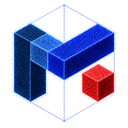
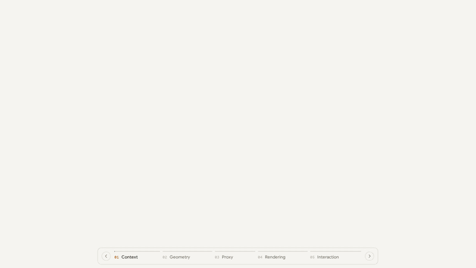

<p align="center">
  
</p>

<h1 align="center">Mundo: Customized World Model</h1>

<p align="center"><b>Turn a few views of a place into a world you can explore, edit, and simulate.</b></p>

<p align="center">
  <a href="https://yihangluo.com/">Yihang Luo</a> ·
  <a href="https://kkakkkka.github.io/">Zunnan Xu</a> ·
  <a href="https://shangchenzhou.com/">Shangchen Zhou</a> ·
  <a href="https://nirvanalan.github.io/">Yushi Lan</a> ·
  <a href="https://kangliao929.github.io/">Kang Liao</a> ·
  <a href="https://scholar.google.com/citations?user=sjiwhzcAAAAJ">Zerui Gong</a> ·
  <a href="https://dravenalg.github.io/">Xiaoming Wu</a> ·
  <a href="https://scholar.google.com/citations?user=fMXnSGMAAAAJ">Qingyi Tao</a> ·
  <a href="https://wu-zhonghua.github.io/">Zhonghua Wu</a> ·
  <a href="https://mundo-world-model.github.io/">Bixuan Jin</a> ·
  <a href="https://scholar.google.com/citations?user=ljt16JkAAAAJ">Fei Wang</a> ·
  <a href="https://zhihou7.github.io/">Zhi Hou</a> ·
  <a href="https://www.ee.cuhk.edu.hk/~xgwang/">Xiaogang Wang</a> ·
  <a href="https://xingangpan.github.io/">Xingang Pan</a> ·
  <a href="https://www.mmlab-ntu.com/person/ccloy/">Chen Change Loy</a>
</p>

<p align="center">
  <a href="https://www.mmlab-ntu.com/">MMLab@NTU</a> ·
  <a href="https://www.ntu.edu.sg/">Nanyang Technological University</a> ·
  <a href="https://www.acerobotics.com/">ACE Robotics</a>
</p>

<p align="center">
  <a href="https://mundo-world-model.github.io/"></a>
  <a href="https://huggingface.co/blog/Luo-Yihang/mundo-world-model"></a>
  
</p>

<p align="center">
  
</p>

<p align="center">
  <sub><b>Context → Geometry → Proxy → Rendering → Interaction.</b> Photos of a hotel room become points, the agent's boxes and a 3D proxy world; a video model renders the proxy, and a robot acts in the same room.</sub>
</p>

## Overview

World models capture the structure, appearance, and dynamics of environments to support reconstruction and simulation. Mundo builds an interactive 3D world from context images, grounding these capabilities in the specific environment they depict. It represents the scene's layout and objects in a 3D proxy, with their physical properties defined in a scene program. A simulator computes motion and interactions, while a video model renders the results using the supplied images as visual context. The resulting world supports spatial exploration, physical interaction, dynamic simulation, and robot tasks within the same customized environment.

## What a Mundo world supports

<table>
  <tr>
    <td width="50%" valign="top">
      <a href="https://mundo-world-model.github.io/#exploration"><b>Spatial exploration</b></a><br>
      Set a camera path through a scene. Mundo generates new views, using the input images as context and filling unseen areas.
    </td>
    <td width="50%" valign="top">
      <a href="https://mundo-world-model.github.io/#interaction"><b>Physical interaction</b></a><br>
      Mundo adds physical properties to the reconstructed scene to simulate how objects move and interact, then renders the motion using the environment's context images.
    </td>
  </tr>
  <tr>
    <td width="50%" valign="top">
      <a href="https://mundo-world-model.github.io/#simulation"><b>Dynamic simulation</b></a><br>
      Mundo simulates how robots and objects move and interact over time in the given scene, and renders the results from external and first-person viewpoints for Real-to-Sim testing and training.
    </td>
    <td width="50%" valign="top">
      <a href="https://mundo-world-model.github.io/#robotics"><b>Robotics application</b></a><br>
      The 3D proxy records where each object is and what it is, so an agent can plan a route between a start and a goal described semantically.
    </td>
  </tr>
</table>

## How it works

1. **Build the proxy world.** A 3D detector gives an initial bounding box for each main object. A VLM agent then refines the proxy world in an analysis-by-synthesis loop, yielding the 3D proxy environment.
2. **Run it as code.** In code, the objects, their poses, their physical properties and the rules that govern them simulate the world and keep track of its interactions and changes.
3. **Render the video.** From the simulated world, Mundo renders proxy frames in flat category colours. A video diffusion model renders them into video, with the context views as visual context.

The [Hugging Face blog](https://huggingface.co/blog/Luo-Yihang/mundo-world-model) walks through each step in detail.

## Release

- [x] [Project page](https://mundo-world-model.github.io/)
- [ ] [Technical blog](https://huggingface.co/blog/Luo-Yihang/mundo-world-model) on Hugging Face
- [ ] Code

## Citation

```bibtex
@misc{luo2026mundo,
  author = {Yihang Luo and Zunnan Xu and Shangchen Zhou and Yushi Lan and
            Kang Liao and Zerui Gong and Xiaoming Wu and Qingyi Tao and
            Zhonghua Wu and Bixuan Jin and Fei Wang and Zhi Hou and
            Xiaogang Wang and Xingang Pan and Chen Change Loy},
  title  = {{Mundo}: Customized World Model},
  year   = {2026},
  url    = {https://mundo-world-model.github.io/}
}
```
